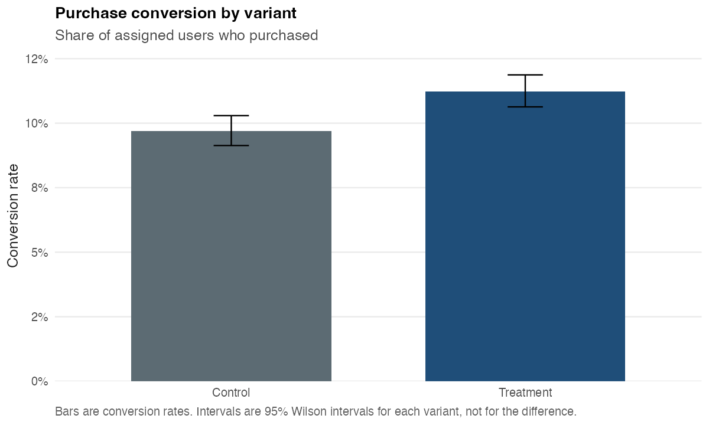
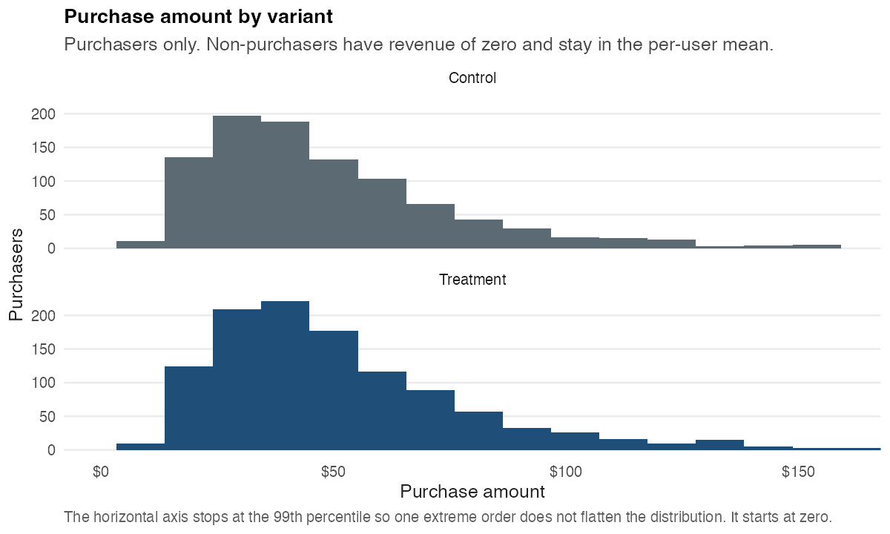
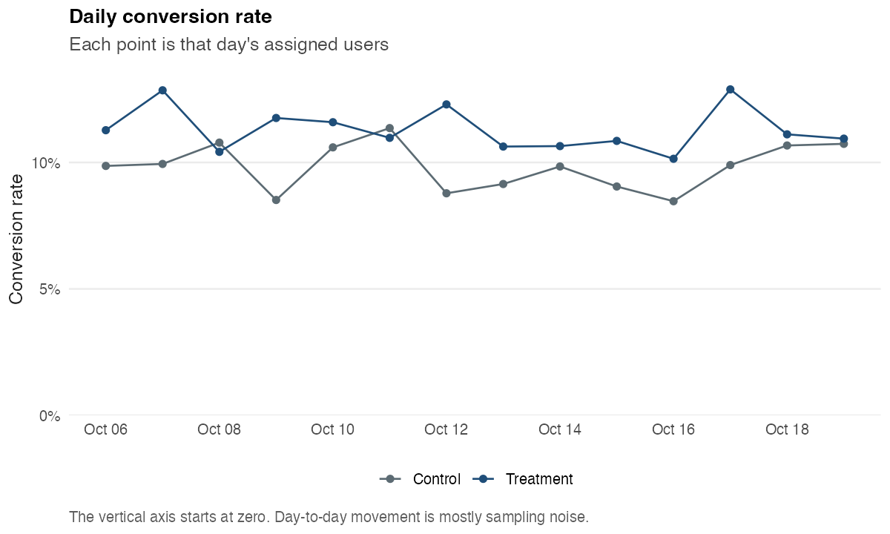
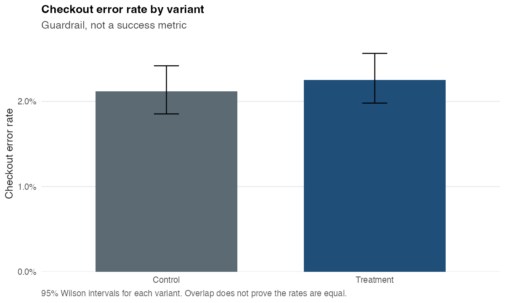

# A/B Testing Analyzer

Synthetic analysis of a checkout redesign. The project randomizes 20,000 users, checks that the experiment is valid, and estimates the effect on purchase conversion, revenue per assigned user, and checkout errors.

All data and results are simulated. They are not evidence about a real checkout.

## Business problem

An e-commerce team wants to know whether a redesigned checkout should replace the current one. Users are assigned 50/50 to the existing checkout (control) or the redesign (treatment). The decision needs a conversion lift that is both statistically supported and large enough to matter, without an unacceptable rise in checkout errors.

## Skills

- Experimental design: randomization, sample ratio mismatch, covariate balance, and pre-experiment sample size
- Inference: two-sample proportion tests, Wald and Newcombe intervals, and a stratified bootstrap for skewed revenue
- Decision rules based on confidence intervals and explicit business thresholds, not a p-value alone
- Tidyverse data wrangling, ggplot2, Quarto, testthat, and renv

## Dataset

`data/synthetic_experiment.csv` has one row per randomized user: assignment time, device, traffic source, country, conversion, revenue, and a checkout-error flag. The seed is `20241119`. The experiment window is 6–19 October 2026 (UTC).

`data/synthetic_experiment_corrupted.csv` is the same draw with a dropped treatment arm, duplicate and missing user IDs, an invalid variant, timestamps outside the window, and conversion values that disagree with revenue. Validation stops the analysis on that file. It does not delete rows quietly.

Missing country and traffic source in the clean file are intentional and are warnings, not reasons to drop users from the primary estimate.

## Method

| Question | Method |
| --- | --- |
| Did conversion change? | Two-sided pooled z-test. The reported interval is the unpooled Wald interval for treatment minus control. A Newcombe score interval is a second check. |
| Did revenue per assigned user change? | Means include users who spent $0. The 95% interval is a percentile bootstrap, stratified by variant, with 2,000 replicates. |
| Did checkout errors get worse? | Same proportion comparison. An interval that includes zero is not treated as proof of safety. |
| Was the experiment valid? | Schema, duplicates, variant labels, conversion/revenue consistency, the experiment window, and a chi-squared sample-ratio check. Covariate imbalance is descriptive. |
| How large a future test needs to be | Normal approximation for two proportions, checked against `power.prop.test` at equal allocation. This is planning math, not observed power. |

Shipping requires the conversion interval to sit entirely at or above a 0.5 percentage-point lift, and the checkout-error interval to sit at or below a 1 percentage-point increase. Those thresholds are arguments to `make_experiment_decision()`.

## Findings

On this simulated sample:

- Control conversion is 9.70%. Treatment conversion is 11.24%.
- The treatment-minus-control difference is +1.54 percentage points (about +16% relative). The 95% Wald interval is +0.69 to +2.39 percentage points. The p-value is 0.00038, and the hand calculation, `broom`, and `infer` agree.
- Revenue per assigned user is $4.82 in control and $5.88 in treatment. The difference is +$1.06, with a 95% bootstrap interval of $0.56 to $1.60.
- Checkout errors are 2.12% versus 2.25%. The difference is +0.14 percentage points, and the 95% interval is −0.27 to +0.54 percentage points.
- A future 50/50 test that wants 80% power for a 1 percentage-point lift from a 10% baseline needs about 14,751 users per variant.
- Device and channel slices are exploratory. Six comparisons are not a license to pick the significant one.

## Recommendation

**Ship**, under the default thresholds. The conversion interval clears the 0.5 percentage-point bar, and the checkout-error interval stays within the 1 percentage-point harm limit. The same recommendation holds if the conversion interval is the Newcombe interval instead of the Wald interval.

This is a property of the simulated draw and the chosen thresholds. A different seed or a stricter error limit can change the call.

## Charts









## Reproduce

R 4.4 or later and [Quarto](https://quarto.org) are required. From the project root:

```bash
Rscript -e 'renv::restore()'
Rscript scripts/run_analysis.R
Rscript -e 'testthat::test_dir("tests/testthat", stop_on_failure = TRUE)'
quarto render report.qmd
```

`scripts/run_analysis.R` regenerates the synthetic tables, writes `figures/`, and prints the decision. `report.qmd` reads those tables and renders `report.html`.

## Layout

```text
R/                  generation, validation, metrics, tests, power, decision, plots
scripts/run_analysis.R
tests/testthat/     metric, validation, inference, power, and decision tests
data/               clean table, corrupted table, generation parameters
report.qmd          13-section write-up
.github/workflows/  restore dependencies, run tests, render the report
```

## Limitations

- Outcomes are independent. There is no interference, no repeat purchase, and no conversion after the window.
- The conversion model is additive in variant, device, channel, and country. Order value is lognormal and does not depend on device or channel.
- The simulator does not change checkout-error probability for the treatment. Mobile users have a higher error probability than desktop users.
- Subgroup intervals are not adjusted for multiple comparisons. A significant slice next to a nonsignificant slice does not show that the effects differ.
- The sample-size formula assumes a two-sided test of two independent proportions and a normal approximation. It is not a substitute for the effect estimate.
